# Battery Tool and fan control: validation report

MacBookPro18,3 (14-inch M1 Pro, 8 performance + 2 efficiency cores, 32 GB), macOS 26.6.2. Measured 19 October 2026.
Raw data: `../results/`. Scripts and how to reproduce: `../README.md`. Code audit: `01-inspection.md`.
Method, limitations, manual procedures: `02-methodology.md`.

## 1. Executive summary

Numbers below are from the repeated main run of 20 Oct (`20261020-163602-abc4`: display kept on, collectors protected,
3 rounds, n = 3 per cell) unless stated; the first run (19 Oct, flaws in §13) is kept and quoted where it adds a range.

- **Extreme Low Power Mode does keep demoted work off the performance cores.** The test job ran **0%** of its CPU
  time on P-cores under Extreme vs 100% in Normal and Low Power Mode; across all demoted user processes 99.99% of CPU
  time ran on efficiency cores. The P-cores still did 6–8% of their usual activity for processes Extreme does not
  touch (system, root, the frontmost app).
- **Under sustained background load it cuts power and heat a lot:** 8 background jobs for 90 s drew 28.6 W (system)
  / 15.3 W (CPU) in Normal, 20.9 / 8.8 W in Low Power Mode, **7.5 / 0.5 W** in Extreme; mean CPU temperature
  73.8 → 64.1 → 48.1 °C.
- **At idle with apps open, display on: 10.5 → 9.6 → 7.7 W (−27% for Extreme, −8% for Low Power Mode)**, n = 3,
  SD < 1 W. The first run, with the display sleeping in some rounds and a Photos indexing burst, showed no idle
  difference; the saving at idle depends on how much the background apps are doing.
- **That saving comes from doing background work more slowly.** A fixed background job that takes 20 s normally took
  **86 s–5 min** in this run (4–16×) and **7–33 min** in the first run (21–100×), because the demoted processes
  (235 here, ~350 then) share two efficiency cores. Because the whole computer stays on meanwhile, finishing the job
  cost **2.5–10× more whole-system energy** here and 20–50× in the first run. Low Power Mode slowed it only 1.3×.
- **Background responsiveness suffers:** a demotable process waiting on a 10 ms timer woke 4.7 ms late (median) in
  Normal and **208 ms** late under Extreme with work queued (p95: 7.4 vs 335 ms).
- **A demoted app brought to the front took 3–31 s (median 10.8 s) to get full speed back**, not "right away".
- **On battery with a light fixed-work background load, Extreme used 32% less charge per hour than Normal** (449 vs
  662 mAh/h; Low Power Mode −9%), n = 2, display on. Estimated runtime on this 77%-health battery: 6.8 → 7.5 → 10.0 h
  (an estimate from measured drain, not a full discharge).
- **Crash and sleep recovery work:** after a `kill -9` the daemon was back in 1.2 s, restored all 302 processes and
  re-applied the mode; after sleep/wake the state matched its record; switching off left nothing demoted.
- **The daemons' own overhead is small:** Battery Tool's daemon used 0.23% of one core over 2.4 days (10 MB), the
  fan daemon 0.03%.
- **Fans:** under an 8-core load at full power, with the fan app's daemon **stopped** (pure Apple firmware), both fans
  stayed at **0 rpm while the CPU reached 97 °C**; in the next round they ran at ~2,350 rpm and the CPU still reached
  98 °C. The app's Auto mode behaved the same. The app's Curve held ~84 °C at ~4,400 rpm.

## 2. Configuration

See `01-inspection.md` for the full table. Battery: 1,624 cycles, 77% of design capacity, *Service Recommended*. All
power runs were on AC with charging held (the Battery Tool charge limit set to the current level), both fans fixed at
maximum (5,780 / 6,240 rpm), the user's normal apps open (114 processes listed by `lsappinfo`).

## 3. Methodology (short)

Configurations A Normal / B Low Power Mode / C Extreme; 3 rounds, order A B C / C B A / A B C, 30 s settle after each
switch. Scenarios: idle 120 s; 8 continuous jobs for 90 s; 1 job of fixed work; 8 jobs of fixed work + latency probe.
One window = one replicate (n = 3 per bar). Three Extreme windows of round 3 partly ran on battery (charger unplugged
by the user) and were re-run on AC; the merged data set is `results/20261019-043311-abc3b-merged` (see `MERGE.txt`).
An earlier full run (`20261019-020632-abc3`) is kept: its per-process snapshots were empty because of a runner bug
(path quoting), and its job results were recovered from its failure log. Under load it agrees with the merged run
(e.g. 1 job: 19.6 / 25.8 / 102–1,386 s); at idle it does not (11.2 / 10.8 / 8.0 W there, Extreme lowest), which is
consistent with idle power being dominated by background activity rather than by the mode. Details and limitations: `02-methodology.md`.

## 4. Core scheduling verification

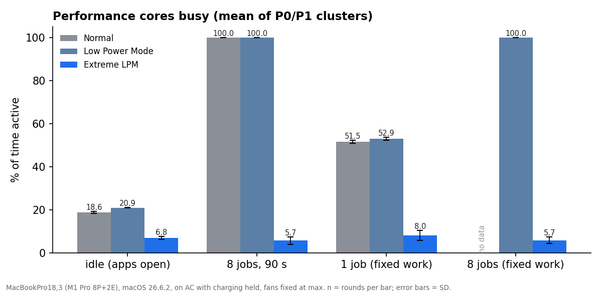

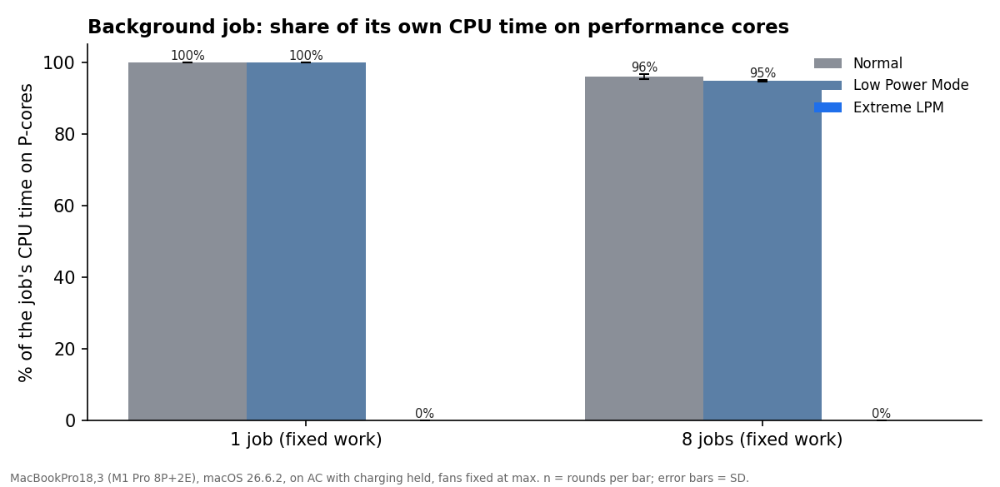

| Evidence (merged run, n = 3) | Normal | Low Power Mode | Extreme |
|---|---|---|---|
| Test job, share of its CPU time on P-cores (1 job / 8 jobs) | 100% / 97% | 100% / 98% | **0.0% / 0.0%** |
| Demoted user processes, share of CPU time on P-cores | — (≈13 demoted by macOS itself) | — | 0.00–0.01% |
| User processes running >90% on E-cores, idle window | 80 | 67 | 238 |
| P clusters busy, 8 jobs for 90 s | 100% at 3,036 MHz | 100% at 2,448 MHz | 11% at 733 MHz |
| E cluster busy, 8 jobs for 90 s | 99% | 89% | 100% |

`taskpolicy -b` does not *guarantee* E-core-only execution, and the P-cores were not idle under Extreme (the system,
root processes and the frontmost app still use them). But for the processes it demotes, the measured P-core share was
zero to two decimal places in every window. Limitation: per-process P-core time is cumulative; it shows the share, not
the timing, and root processes cannot be inspected without root.

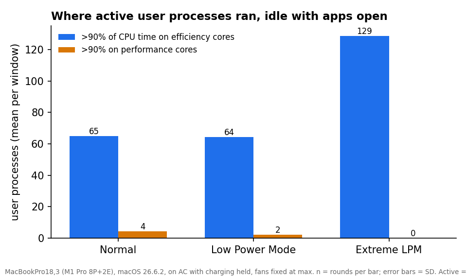

## 5. CPU and system power

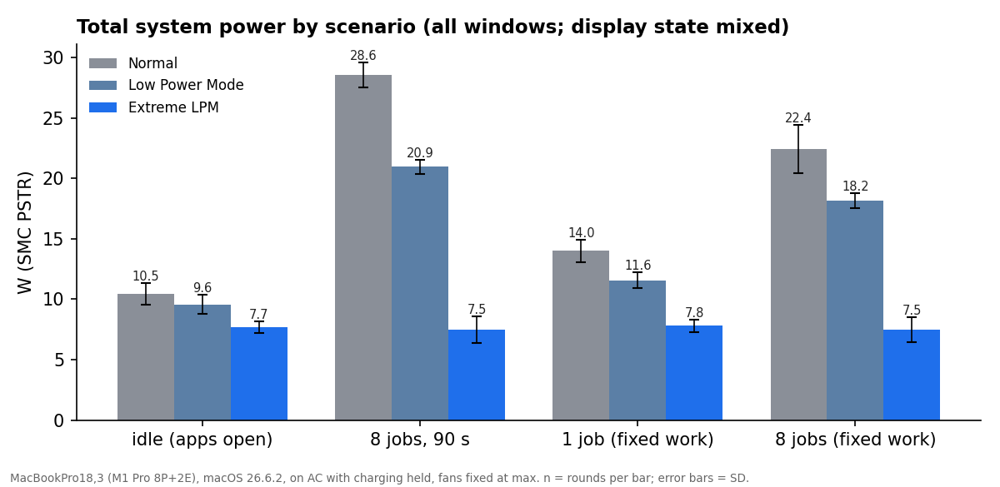

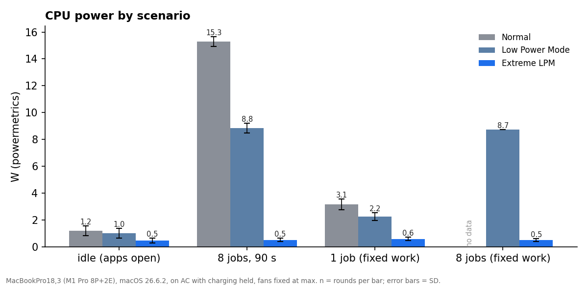

| Mean ± SD (n = 3), display on | Normal | Low Power Mode | Extreme |
|---|---|---|---|
| System power, idle with apps open | 10.45 ± 0.91 W | 9.57 ± 0.76 W (−8%) | 7.67 ± 0.46 W (−27%) |
| System power, 8 jobs for 90 s | 28.55 ± 1.06 W | 20.94 ± 0.58 W (−27%) | 7.46 ± 1.10 W (−74%) |
| CPU power, idle | 1.18 ± 0.36 W | 1.00 ± 0.36 W | 0.45 ± 0.19 W |
| CPU power, 8 jobs for 90 s | 15.29 ± 0.38 W | 8.84 ± 0.35 W (−42%) | 0.50 ± 0.13 W (−97%) |
| P clusters busy, idle | 18.6% | 20.9% | 6.8% |

System power is the whole computer (SMC `PSTR`, on AC, checked against battery V × I on battery: within ~10%). CPU
power is powermetrics' estimate for the CPU alone. In the first run (19 Oct) the display slept during rounds 2–3 and the
Extreme round-3 redo ran with it on; its display-matched idle numbers (9.4 / 10.2 / 10.8 W on, 5.4 / 5.1 / 4.5–6.7 W
off, n = 1–2) showed no idle saving, while this controlled run does. At idle, the demoted processes used 0.7–1.0 cores
of efficiency-core time in both runs; what differs is how much P-core work the rest of the system did.

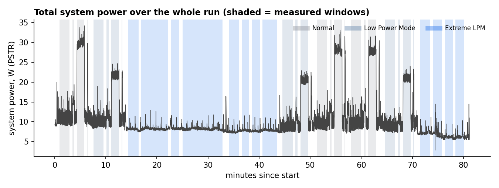

## 6. Battery consumption

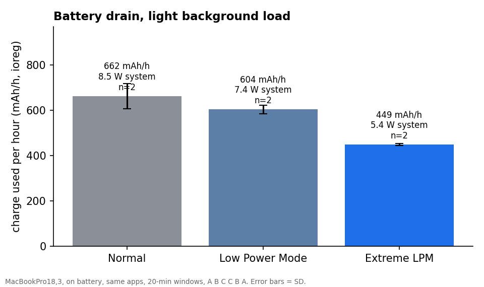

Unplugged, display kept on (`caffeinate -di`), same apps, a light **fixed-work** background load (700 SHA-256 hashes of
1 MiB every 10 s, about 0.3 s on a performance core; 118–120 bursts per window in every mode), 20-minute windows, order
A B C C B A, from 80% down to 57%. Run `20261020-193930-battery4`.

| n = 2 per mode | Normal | Low Power Mode | Extreme |
|---|---|---|---|
| Charge used per hour (ioreg counter) | 662 ± 55 mAh | 604 ± 19 mAh (−9%) | 449 ± 4 mAh (−32%) |
| Whole-system power (SMC `PSTR`) | 8.50 ± 0.53 W | 7.41 ± 0.09 W (−13%) | 5.42 ± 0.01 W (−36%) |
| P clusters busy | 19% | 19% | 5% |
| **Estimated** runtime from full (4,501 mAh) | 6.8 h | 7.5 h | 10.0 h |

The two independent measures (charge counter, SMC power) agree on the ranking and roughly on the size. With n = 2
the Normal vs Low Power Mode difference is about one SD apart; Extreme vs Normal is far outside the spread. The
runtime is an estimate (measured drain extrapolated to the present full capacity), not a full discharge; an aged
cell's capacity figure is itself uncertain. SMC `PPBR` reads ~12% above both other measures and is not used.
The first battery attempt (`…-battery3`, time-based load, −25%) and an invalid one (`…-091228-battery`, the Mac slept)
are kept with notes.

## 7. Thermal results

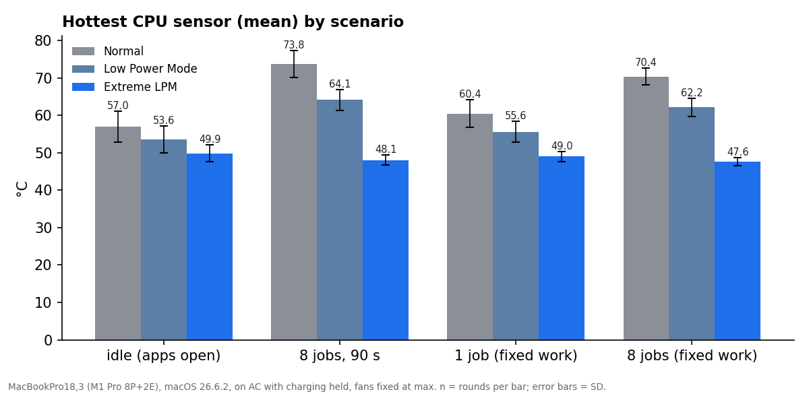

| Hottest CPU sensor, mean (peak), n = 3 | Normal | Low Power Mode | Extreme |
|---|---|---|---|
| Idle with apps open | 57.0 (65.4) °C | 53.6 (59.0) °C | 49.9 (55.9) °C |
| 8 jobs for 90 s | 73.8 (78.8) °C | 64.1 (67.4) °C | 48.1 (53.7) °C |
| 1 job, fixed work | 60.5 (62.7) °C | 55.6 (58.4) °C | 49.0 (55.2) °C |

Both fans ran at maximum throughout, so these temperatures are lower than with Apple's fan control and the differences
between modes smaller. Battery temperature and the `Ts0P` "palm rest" sensor did not differ between modes in these
short windows. **Chassis temperature was not measured** (no IR thermometer); procedure in `02-methodology.md`.

## 8. Workload performance and energy per task

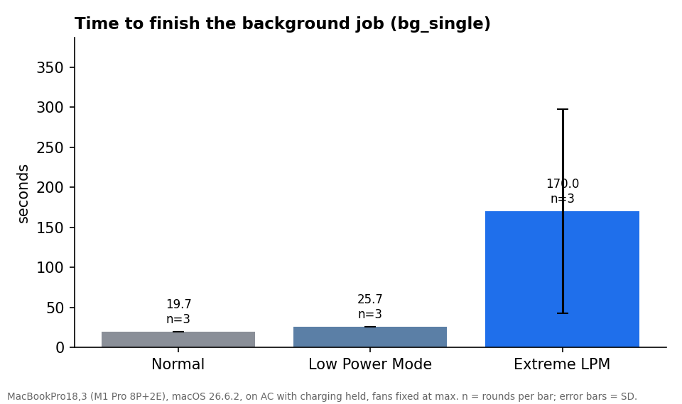

| Fixed work, n = 3 | Normal | Low Power Mode | Extreme (this run) | Extreme (first run) |
|---|---|---|---|---|
| 1 job: time | 19.7 s | 25.7 s (1.3×) | 86 / 118 / 317 s (4–16×) | 414 / 693 / 1,960 s (21–100×) |
| 1 job: its CPU time | 19.7 s | 25.7 s | 33–34 s | 34–35 s |
| 1 job: OS energy estimate for the job itself | 36 J | 26 J | 6.6 J | 6.6 J |
| 1 job: whole-system energy until done | 272 ± 19 J | 294 ± 22 J | 675–2,600 J (2.5–10×) | 4,520–9,590 J (20–50×, display mixed) |
| 8 jobs: time | 5.6 s | 6.9 s (1.2×) | 95 / 160 / 457 s (17–81×) | 135 / 563 / 2,246 s |
| 8 jobs: whole-system energy until done | 112 J | 115 J | 604–3,870 J | 567–22,900 J |
| Demoted processes during the run | — | — | 235 | ~350 |

**Lower power is not lower energy.** On an efficiency core the job's own computation cost ~5× less energy (6.6 J vs
36 J), but it took 33 s of CPU instead of 20 s and then waited most of the time, while the rest of the computer drew
~7–8 W. How long it waits depends on how much the other demoted processes want the two efficiency cores: with 235
demoted processes the job got 10–40% of a core, with ~350 (first run) 2–8%. The slowdown is therefore highly
variable, from 4× to 100× for one job, and the whole-system energy from 2.5× to 50× that of Normal. Low Power Mode,
by contrast, cost 1.2–1.3× in time and about the same energy.

**Where Extreme helps:** light background activity (a music tab, sync, chat) while you use one foreground app; long
sessions where cool and quiet matter more than background throughput. **Where it is counterproductive:** any background
job you are waiting for (builds, exports, downloads that need CPU, indexing).

## 9. Responsiveness

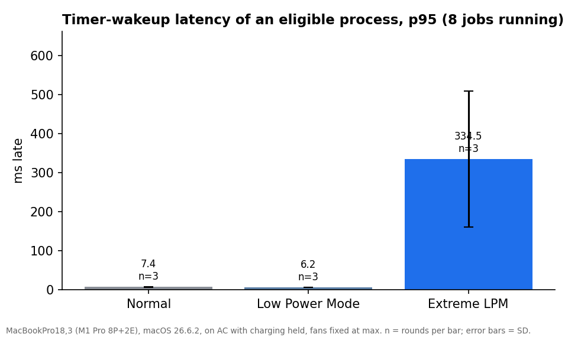

| | Normal | Low Power Mode | Extreme |
|---|---|---|---|
| Timer wake-up delay of a demotable process, median / p95 (8 jobs queued), n = 3 | 4.7 / 7.4 ms | 3.8 / 6.2 ms | 208 / 335 ms (first run: 340 / 868 ms) |
| Demoted app brought to front → full speed again (n = 10, 19 Oct) | — | — | median 10.8 s, range 3.1–31.3 s |

The design lets a new frontmost app wait up to one scan (~5 s); the measured times are longer because each switch makes
the daemon demote the previous app's ~60 processes and restore the new one's, one `taskpolicy` call each, while it
is itself competing for CPU. Child processes of the frontmost app outside its bundle stay demoted (code audit).

## 10. Utility overhead

| Process | CPU over lifetime | Share of one core | Memory |
|---|---|---|---|
| `battery-tool daemon` (root) | 482 s over 2 d 9 h | 0.23% | 10 MB |
| `BatteryTool` menu app | 554 s over 2 d 9 h | 0.27% | 47 MB |
| `macfanctld` (fan daemon) | 912 s over 42 d | 0.03% | — |

Not included: the short-lived commands the daemon launches (per 5 s tick: `ioreg`, `pmset`; per scan: 4 process
launches for `lsappinfo`, one `taskpolicy` per change — about 360 on activation and ~60 on every foreground switch).
Their cost is not captured by `ps` and was not isolated; at idle it is below the measurement noise of system power here.
Collector overhead: the 1 s SMC sampler and snapshots ran in every condition equally.

## 11. Fan control

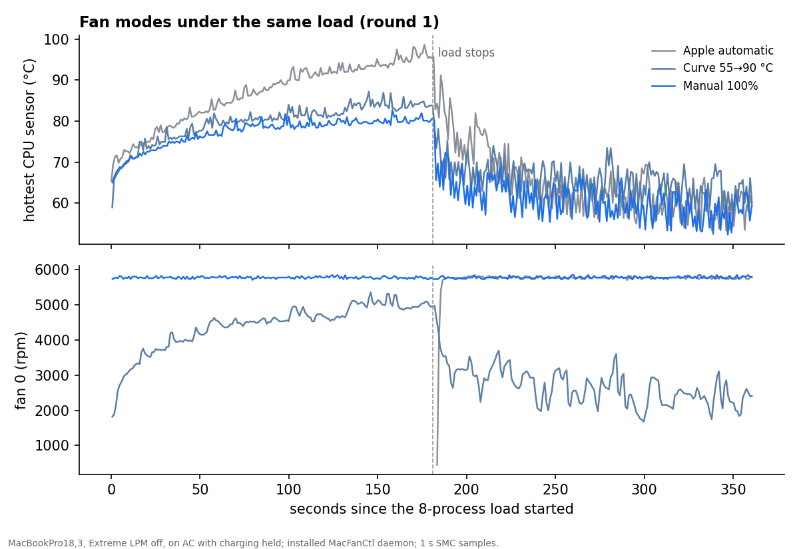

First fan test (19 Oct, `20261019-033931-fans`): same 8-process load for 3 min, Extreme off, Low Power Mode off, on AC
with charging held, 2 rounds per mode, installed MacFanCtl daemon.

| Mode | CPU, last 60 s of load | Peak | Fan 0 | Cool-down: CPU, last 60 s |
|---|---|---|---|---|
| Auto (Apple firmware via the app) | > 95 °C, safety stop after 180 s / 57 s | 98.4 °C | **0 rpm** | not comparable (fans set to 100% by the guard) |
| Curve 55 → 90 °C | 83.7 ± 0.1 °C | 86.4 °C | 4,370 rpm | 68.9 °C |
| Manual 100% | 83.1 ± 4.3 °C | 86.0 °C | 5,780 rpm | 58.1 °C |

Is that the firmware or the app? The app's Auto mode rewrites the fan-mode register every 2 s. Second test
(`20261020-160551-fanfw`, Low Power Mode forced off, same load): fan daemon **stopped** (pure Apple control) vs the
app's Auto, order firmware / app / app / firmware.

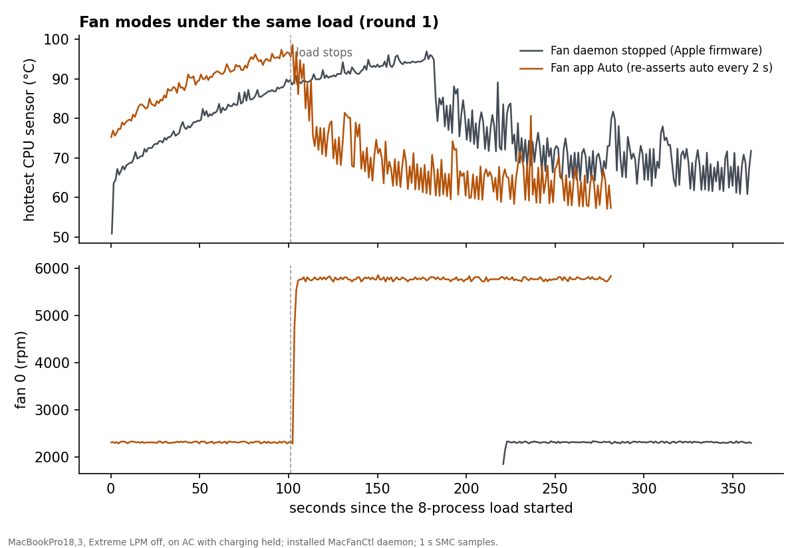

| Round | Fans during the load | CPU peak | Safety stop (≥ 95 °C for 10 s) |
|---|---|---|---|
| Firmware, round 1 | **0 rpm for all 181 s** | 97.0 °C | no (not 10 s continuous) |
| App Auto, round 1 | ~2,340 rpm (left on by the firmware from the previous cool-down) | 97.4 °C | yes, at 101 s |
| App Auto, round 2 | ~2,340 rpm | 100.8 °C | yes, at 115 s |
| Firmware, round 2 | ~2,350 rpm | 97.8 °C | yes, at 131 s |

Under this load Apple's firmware lets the chip sit at 95–100 °C with the fans off or at ~2,350 rpm (of 5,780); the app's
Auto mode behaved the same. Apple Silicon Macs are known to run hot and throttle rather than spin up, so this is not a
fault, but it is the reason the Curve (84 °C at ~4,400 rpm) feels different. Two earlier attempts at this test are
invalid and kept with notes (stopped by hand; loaded by leftover processes; run with Low Power Mode on). Code issues in
the fan daemon (0 rpm target on a failed min/max read, NaN targets, a hangable config) are in `01-inspection.md`.

## 12. Reliability

Run `20261020-013054-reliability` (on AC). Each step compares the darwin-background processes of the user (from
`proc_pidinfo`) with Battery Tool's change record (`changes.tsv`), against a baseline taken with Extreme off (the
processes macOS itself keeps in the background).

| Step | Demoted beyond baseline | Recorded | Demoted, not recorded | Recorded, not demoted | Frontmost demoted | Low Power Mode |
|---|---|---|---|---|---|---|
| S0 Extreme off (baseline) | 0 | 0 | 0 | 0 | no | 1 / 1 |
| S1 Extreme on, 30 s | 304 | 302 | 2 (`pgrep`, `proccores`) | 0 | no | 1 / 1 |
| S2 daemon `kill -9`, +60 s | 304 | 302 | 2 (same) | 0 | no | 1 / 1 |
| S3 after sleep and wake, +30 s | 302 | 302 | 1 (`proccores`) | 1 | no | 1 / 1 |
| S4 Extreme off again | **0** | 0 | 0 | 0 | no | 1 / 1 |

- **Crash recovery works.** After SIGKILL, launchd restarted the daemon in **1.2 s**; it found its change record
  ("302 processes; restoring it"), restored all 302, then re-applied the mode. The record had no malformed lines at any step.
- **Sleep/wake is clean.** State after wake matched the record; Low Power Mode stayed on. The sleep lasted 37 s
  instead of the planned ~150 s because the Mac was woken by hand; the post-wake checks are unaffected.
- **Turning the mode off restores everything** it demoted (0 left beyond the baseline).
- The "demoted, not recorded" entries are the test's own short-lived measurement commands, children of an already
  demoted shell that inherited its policy after the last scan; Battery Tool records such children at its next scan.
  The single "recorded, not demoted" entry at S3 is a process that changed state between scan and snapshot.
- Also verified in the other runs: every run restored the Battery Tool mode, auto-trigger and charge limit; Low Power
  Mode originals were recorded correctly.
- Found earlier: when something else changes Low Power Mode while Extreme is active, Extreme keeps running without it
  (Battery Tool only applies Low Power Mode at activation); the front-app latency (§9); the code-audit issues (PID
  reuse window, frontmost unknown, children outside the app bundle) — reported, not fixed.
- **Low Power Mode drift (caused by my test helpers, not by normal use):** the benchmark's root helper restored the Low
  Power Mode values it found at start, and several of those starts happened while Extreme mode had already switched
  Low Power Mode on. Battery Tool then recorded "on" as the original, so after testing Low Power Mode stayed on with
  Extreme off. In normal use only Battery Tool changes it, so this does not arise; the fix for this Mac is
  System Settings → Battery → Low Power Mode → Never.
- Not tested: uninstall (it removes the tool), unexpected power loss.

## 13. Experimental flaws found in review (20 Oct), and what was done about them

| # | Flaw | Effect | Fix |
|---|---|---|---|
| 1 | **Display state was not controlled** on the AC runs. The screen slept at 05:04 (round 1 was on, rounds 2–3 off), and the Extreme round-3 redo ran with it on. The display is ~4–5 W of system power. | Whole-system power and energy-per-task mixed display states; the Extreme redo windows were biased **against** Extreme. CPU power, temperature, core split and job times are unaffected. | Analysis now records the display state per window (from `pmset -g log`) and reports system power separately for display on/off. The runner now keeps the display on (`caffeinate -d`). Main run repeated. |
| 2 | **Battery-test load was time-based** (hash for 0.3 s every 10 s). A demoted process gets 2–8% of a core, so under Extreme each burst did roughly 35× less work. | The −25% battery drain is an upper bound: part of it is work not done. | `light.py` now does fixed work per burst (700 hashes ≈ 0.3 s on a P-core). Battery test repeated. |
| 3 | **Fan-vs-firmware test ran with macOS Low Power Mode on** (a leftover from an earlier run), the first fan test with it off. CPU reached ~80 °C instead of ~95 °C. | "Fans stay off with the daemon stopped" was shown only up to ~80 °C at capped clocks, not at full power. | The script now forces Low Power Mode off and records it. Test repeated. |
| 4 | **Uncontrolled system background work:** in one Extreme idle window Photos' `mediaanalysisd` (a system process, never demoted) used ~6 cores for 2 min (708 CPU-s). | That window (8.8 W, P-cores 81% busy) is an outlier in the idle means. | Flagged; idle statistics reported with and without it. It is also a finding: macOS's own background jobs are outside Extreme's reach. |
| 5 | **Collectors were demoted under Extreme** (the SMC sampler and process snapshots run as the user). | Fewer telemetry samples in Extreme windows (≈ 80% of normal), thinnest when the E-cores were busiest. Means barely affected in steady windows. | The runner now adds `telemetry` and `proccores` to Battery Tool's protected names for the run (config only, restored after). |
| 6 | **Battery runtime was estimated from SMC `PPBR` × voltage.** `PPBR` reads ~12% above both `PSTR` and the battery's own charge counter. | Runtime estimates were ~10% too low. | Runtime now from the ioreg charge counter (mAh used per hour ÷ present capacity). |
| 7 | **Reliability test's "Low Power Mode still on after wake" check** was meaningless: Low Power Mode was already stuck on before the test (flaw 3's leftover). | Only that one check. The process-policy checks stand. | Script now sets a known state first. Not repeated (the process checks are the point). |
| 8 | **Low Power Mode drift between runs:** my root helper restored the values it saw at start, sometimes while Extreme had already switched them on, so Battery Tool later recorded "on" as the original. | No measured window was affected (each condition sets and verifies Low Power Mode), but the Mac was left with Low Power Mode on. | Documented; the user resets it in System Settings. Not a Battery Tool bug in normal use. |
| 9 | **Runner bugs** (first main run): job output parsed as a number; process snapshots empty (unquoted path with a space). | First run's job results recovered from its failure log; its per-process data lost. | Fixed; the run is kept with a note and not used. |

Display-matched re-analysis of the first main run (`20261019-043311-abc3b-merged`), for the record (n = 1–2):

| System power, W | Normal | Low Power Mode | Extreme |
|---|---|---|---|
| Idle, display on | 9.4 | 10.2 | 10.8 |
| Idle, display off | 5.4 | 5.1 | 6.7 (4.5 without the `mediaanalysisd` window) |
| 8 jobs 90 s, display on / off | 29.6 / 24.3 | 23.0 / 17.1 | 8.4 / 4.1 |
| 1 job, whole-system energy, display on / off | 245 / 192 J | 327 / 161 J | 4,820 / 9,590 J |

The conclusions did not change: no idle saving in either display state; a large saving under background load; 20–50× more
whole-system energy for a fixed background job. Sections 5, 7, 8, 9 and 11 now use the repeated runs.

## 14. Limitations

One machine, aged battery, fans at maximum, real background apps (variance on purpose), short windows, n = 3,
community-documented SMC keys, cumulative per-process core time, user processes only. Full list: `02-methodology.md`.

## 15. Reproducibility

`../README.md` (build, dry run, full run, analysis, fan test, front-app test, battery protocol).

## 16. Recommended next experiments

1. A longer battery test (more rounds, and with real apps such as video playback) and one full discharge per mode.
2. Chassis temperature with an IR thermometer, 15-minute steady state per mode (procedure + template ready).
4. Idle with a controlled background load (e.g. a music tab) and more rounds, to size the saving for "light
   background activity" properly.
5. Extreme with fewer demoted processes (e.g. only apps with a window) to see whether throughput recovers.
6. Uninstall and power-loss recovery, on a spare machine.
